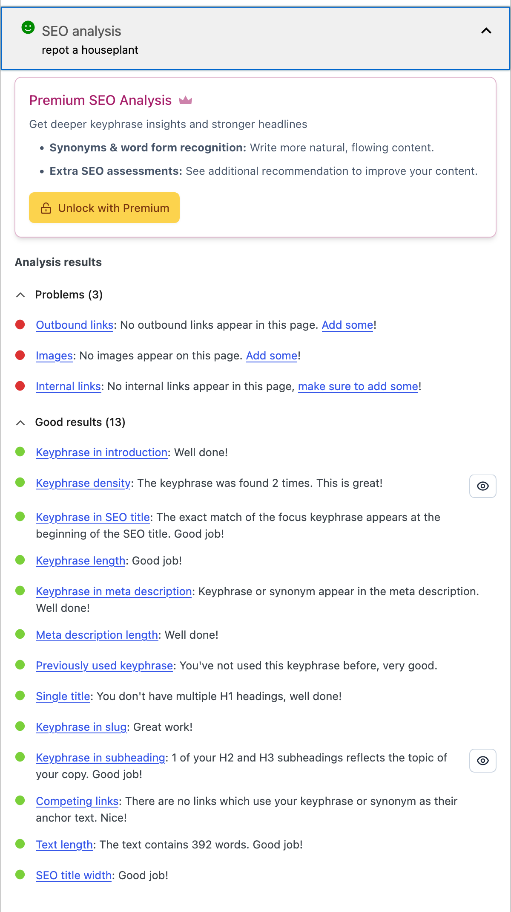
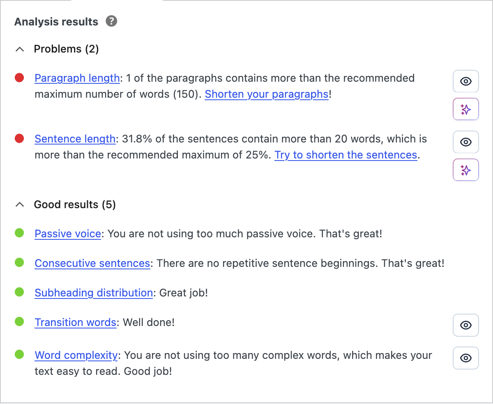
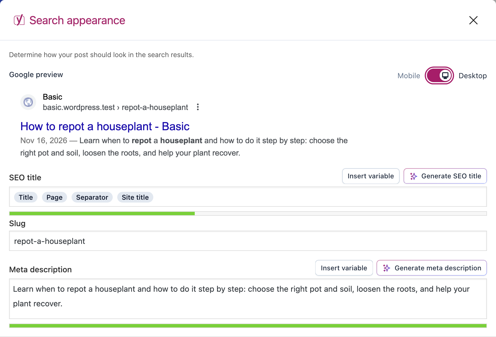
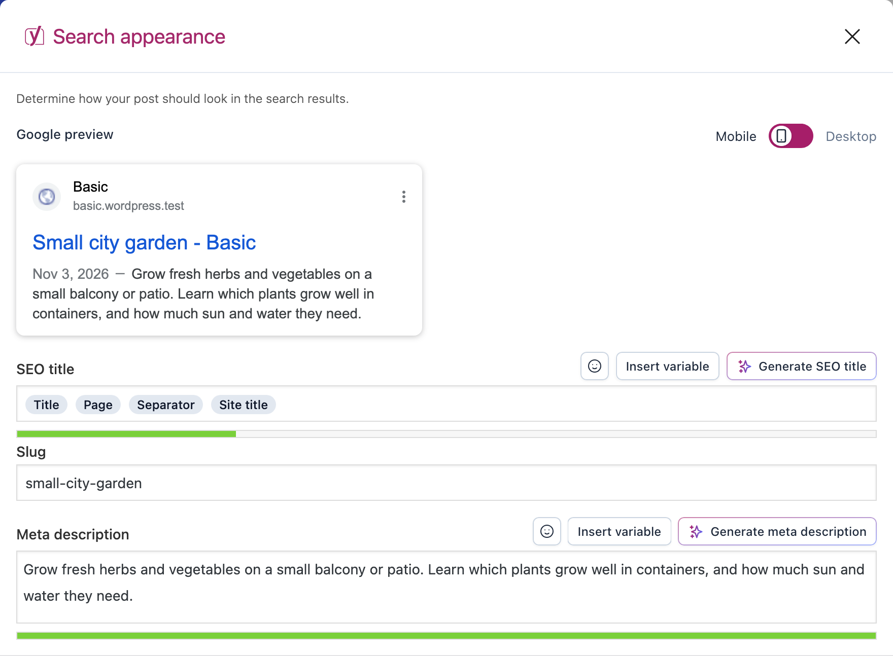

This documentation provides information about how [Yoast SEO](https://yoast.com/product/yoast-seo-wordpress/) analyzes content.

## Content analysis & meta controls
Our JavaScript content analysis tool, [`yoastseo`](https://github.com/Yoast/wordpress-seo/tree/trunk/packages/yoastseo), is able to analyze content for a whole range of SEO, accessibility and readability checks. See [Assessments](assessments/overview.md) for all checks and how they are scored.

The preview of how the page will (probably) look in Google search results is a separate package, [`@yoast/search-metadata-previews`](https://github.com/Yoast/wordpress-seo/tree/trunk/packages/search-metadata-previews). In Yoast SEO, it is shown in the **Search appearance** section: a **Google preview** with a **Mobile** and **Desktop** mode, and fields to edit the **SEO title**, **Slug** and **Meta description**.

Example of the SEO & accessibility checks

Example of the readability checks

Google preview (desktop)

Google preview (mobile)

These UI elements should be integrated into the content editing experience and should update in a real-time or semi-realtime manner. For inspiration, implementors are recommended to take a look at how these elements are integrated into [Yoast SEO for WordPress](https://wordpress.org/plugins/wordpress-seo/).

## Advanced page controls
Users should also be able to define the following for any given page:

| Setting | Behavior |
| ---- | -- |
| Whether search engines should show the page in search results (yes / no) | Sets a *meta robots* value of `noindex` |
| Whether search engines should follow links on the page (yes / no) | Sets a *meta robots* value of `nofollow` |
| Advanced meta robots directives | Allows users to select additional (valid) *meta robots* values |
| Breadcrumbs title | Defines the title of the page as/when used in breadcrumbs (markup and structured data) |
| Canonical URL | Allows users to define a custom canonical URL value |

## Schema controls
| Setting | Behavior |
| -- | ---- |
| Page type | The type(s) of `WebPage` that should be used in the schema graph |
| Article type | The type(s) of `Article` that should be used in the schema graph. Only available on 'post' types. |
